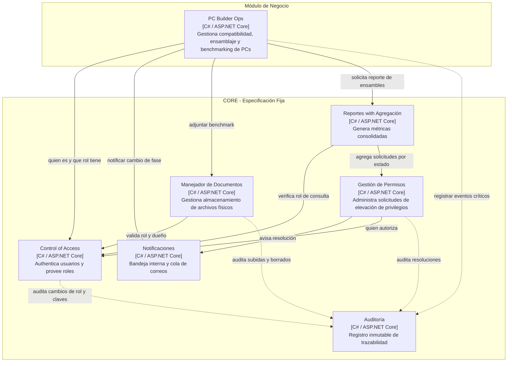

# PC Builder Ops

> **Sistema de Gestión de Ensamblaje y Pruebas de Computadoras Custom Para Empresas**  
> Proyecto de la asignatura **Programación III (TDS-007)** — ITLA (2026-C-3)

---

## Descripción del Proyecto
Plataforma orientada a talleres técnicos y tiendas especializadas de hardware para gestionar el ciclo operativo completo de computadoras personalizadas a pedido. El sistema valida la compatibilidad física y eléctrica de los componentes durante la cotización, coordina las etapas de montaje físico, y garantiza el control de calidad mediante el registro de pruebas de estrés térmico y estabilidad (benchmarking) antes de autorizar la entrega final al cliente.

## Stack Tecnológico
* **Lenguaje & Framework:** C# / .NET 10 (ASP.NET Core Web API)
* **Persistencia:** Entity Framework Core con base de datos relacional (SQL Server)
* **Autenticación & Seguridad:** JWT (JSON Web Tokens) con BCrypt y hashing salado
* **Arquitectura:** Diseño modular basado en componentes (C4 Nivel 3) con desacoplamiento estricto del Core

---

## Arquitectura del Sistema (Diagrama C4 Nivel 3)
El sistema se compone de seis piezas fijas del Core y el módulo de negocio independiente:



---

## Variables de Entorno Requeridas

Conforme a las directivas de seguridad **RF-NOT-13** y **RD-10**, ninguna credencial ni secreto se encuentra versionado en el código fuente. Configure las siguientes variables en el entorno de ejecución, consola o en su archivo local excluido de Git (`launchSettings.json`):

### Cadena de conexión a base de datos

La aplicación resuelve la cadena de conexión en el siguiente orden de prioridad:

1. `CONNECTION_STRING` (variable de entorno directa)
2. `ConnectionStrings__DefaultConnection` (formato doble guion bajo para variables de entorno)
3. `ConnectionStrings:DefaultConnection` (formato estándar de configuración .NET)
4. Fallback local: `Server=localhost;Database=PCBuilderOps;Trusted_Connection=True;TrustServerCertificate=True`

### Clave secreta para JWT

La configuración de tokens se lee únicamente de variables de entorno, en un solo punto del código (`ConfiguracionJwt`), y la usan tanto la emisión como la validación de tokens. **No existe ninguna clave por defecto:** si `JWT_SECRET` falta o es demasiado corta, la API no arranca y lo indica en la consola.

| Variable | Obligatoria | Propósito |
|----------|-------------|-----------|
| `JWT_SECRET` | Sí | Clave de firma HMAC-SHA256 de los tokens. Mínimo 32 caracteres; use un valor aleatorio propio. |
| `JWT_ISSUER` | No (`PCBuilderOps`) | Emisor esperado del token. |
| `JWT_AUDIENCE` | No (`PCBuilderOps`) | Audiencia esperada del token. |
| `JWT_EXPIRACION_MINUTOS` | No (`60`) | Duración del token en minutos. |

Un valor adecuado para `JWT_SECRET` puede generarse en PowerShell con:

```powershell
[Convert]::ToBase64String((1..48 | ForEach-Object { Get-Random -Maximum 256 }))
```

> `JWT_SECRET` también debe estar definida al aplicar las migraciones (`dotnet ef database update`), porque la herramienta arranca la API para leer su configuración.

### Credenciales SMTP

| Variable | Alternativa | Propósito |
|----------|-------------|-----------|
| `SMTP_HOST` | — | Host del servidor SMTP (ej. smtp.gmail.com). |
| `SMTP_PORT` | — | Puerto de conexión al servidor SMTP (465 para SSL, 587 para STARTTLS). |
| `SMTP_USER` | — | Usuario o cuenta de correo autenticada ante el servidor SMTP. |
| `SMTP_PASS` | `SMTP_PASSWORD` | Contraseña de aplicación o token de autenticación SMTP. |
| `SMTP_FROM` | — | Dirección de remitente que figurará en el encabezado de los correos salientes. |

### Administrador inicial

El registro público siempre crea usuarios **Estándar**. Para disponer del primer **Administrador**, defina estas variables antes de ejecutar la API:

| Variable | Propósito |
|----------|-----------|
| `ADMIN_CORREO` | Correo del primer Administrador. |
| `ADMIN_PASSWORD` | Contraseña del primer Administrador (mínimo 8 caracteres, con letras y números). |

Al arrancar, si la base de datos **no tiene ningún Administrador**, la API crea esa cuenta ya activa y con rol Administrador (si el correo ya estaba registrado, lo promueve y le asigna esa contraseña). Si ya existe algún Administrador, las variables se ignoran, por lo que reiniciar la aplicación no duplica ni modifica cuentas. La consola indica si el Administrador fue `Creado` o `Promovido`, o advierte si faltan las variables.

---

## Cómo ejecutar el proyecto

### 1. Clonar y preparar

```bash
git clone https://github.com/Joshua-Abreu/P3-PCBuilderOps.git
cd P3-PCBuilderOps
git checkout practica-1
```

### 2. Restaurar dependencias

```bash
dotnet restore
```

### 3. Aplicar migraciones de base de datos

El proyecto Core contiene el `AppDbContext` y las migraciones. No existe el proyecto `src/Infrastructure`. Use el siguiente comando:

```bash
dotnet ef database update --project src/Core --startup-project src/API
```

Para generar una nueva migración después de cambios en el modelo:

```bash
dotnet ef migrations add <NombreMigracion> --project src/Core --startup-project src/API
```

### 4. Compilar

```bash
dotnet build P3-PCBuilderOps.slnx
```

### 5. Ejecutar

**API Web:**
```bash
dotnet run --project src/API
```

La API quedará escuchando en `http://localhost:5206` (o el puerto configurado en su perfil de host).

**Despachador independiente de correos:**
```bash
dotnet run --project src/Workers/EmailDispatcher
```

Este proceso independiente lee los correos pendientes de la cola, los envía vía SMTP y termina su ejecución limpiamente.

---

## Guía de Verificación de Criterios de Aceptación

Para reproducir cada criterio de la Práctica 1 se provee `src/API/API.http`, que puede ejecutarse desde Visual Studio Code (extensión REST Client) o importarse en Postman. Los tokens de activación y recuperación llegan por correo; si el despachador no está configurado, pueden leerse directamente en las tablas `TokensActivacion` y `TokensRecuperacion`.

### 1. Registro y activación (Bloque 1.1)

| Criterio | Cómo provocarlo | Resultado esperado |
|----------|-----------------|--------------------|
| **RF-CA-01** (Correo único) | `POST /api/auth/registro` con datos válidos y repetirlo con el mismo correo. | El primero retorna `201 Created`; el segundo, `400 Bad Request` con mensaje controlado. |
| **RF-CA-02** (Hash con sal) | Registrar dos usuarios con la misma contraseña y ejecutar `SELECT Correo, PasswordHash FROM Usuarios`. | La contraseña no aparece en texto plano y los dos valores almacenados son distintos (BCrypt con sal aleatoria). |
| **RF-CA-14** (Política de contraseña) y **RD-07** | Registrar con una contraseña de 5 caracteres, sin números o sin letras, y con un correo mal formado o vacío. Repetir la contraseña inválida en `POST /api/auth/cambiar-password` y en `POST /api/auth/restablecer-password`. | `400 Bad Request` con mensaje controlado en todos los casos, nunca una excepción sin manejar. |
| **RF-CA-15** (Cuenta inactiva hasta activar) | Iniciar sesión justo después de registrarse. | `401` con el mensaje "La cuenta no está activa." El correo de activación queda `Pendiente` en `CorreosEnCola`. |
| **RF-CA-16** (Enlace de un solo uso con vencimiento) | Abrir el enlace recibido (`GET /api/auth/activar?token=...`), abrirlo otra vez e iniciar sesión. | Primera apertura `200 OK`; segunda `400` sin cambiar el estado. El inicio de sesión funciona tras activar. El enlace vence a las 24 horas. |
| **RF-CA-17** (Reenvío neutro) | `POST /api/auth/reenviar-activacion` con un correo inexistente y con uno pendiente de activar. | Respuesta idéntica (`200 OK`) en ambos casos. El enlace anterior deja de servir. |

### 2. Sesión (Bloque 1.2)

| Criterio | Cómo provocarlo | Resultado esperado |
|----------|-----------------|--------------------|
| **RF-CA-03** (Inicio de sesión) | `POST /api/auth/login` con credenciales correctas, con contraseña incorrecta y con un correo inexistente. | Correctas: `200 OK` con token. Los dos rechazos son idénticos: `401` "Credenciales incorrectas." |
| **RF-CA-07** (Usuario autenticado) | `GET /api/auth/yo` con y sin cabecera `Authorization: Bearer <TOKEN>`. | Con token: identificador, correo y rol. Sin token: `401`. |
| **RF-CA-18** (Cierre de sesión) | `POST /api/auth/logout` y volver a usar el mismo token en `GET /api/auth/yo`. | El token cerrado se rechaza con `401`. |
| **RF-CA-19** (Bloqueo por intentos) | Fallar la contraseña cinco veces seguidas y en el sexto intento usar la correcta. | El sexto intento se rechaza indicando el bloqueo durante 15 minutos. Un inicio de sesión correcto antes del bloqueo pone el contador en cero. |

### 3. Roles y administración de usuarios (Bloque 1.3)

> **Requisito previo:** iniciar sesión con el Administrador definido en `ADMIN_CORREO` / `ADMIN_PASSWORD` (ver [Administrador inicial](#administrador-inicial)) y usar su token en las peticiones de esta sección.

| Criterio | Cómo provocarlo | Resultado esperado |
|----------|-----------------|--------------------|
| **RF-CA-04** (Dos roles) | `GET /api/usuarios` como Administrador. | Cada usuario tiene exactamente un rol: `Estandar` o `Administrador`. |
| **RF-CA-05** (Exigencia de rol en un punto) | Revisar `src/API/Controllers`. | Cada controlador declara su exigencia con `[Authorize]` o `[Authorize(Roles = "Administrador")]`. |
| **RF-CA-06** y **RD-06** (Rechazo a Estándar) | Con token de un usuario Estándar, invocar a mano `GET /api/usuarios` o `PUT /api/usuarios/{id}/rol`. | `403 Forbidden`. Sin token: `401`. |
| **RF-CA-08** (Cambio de rol) | Como Administrador, `PUT /api/usuarios/{id}/rol`. Como Estándar, intentar cambiar el rol propio. | Administrador: `200 OK`. Estándar: `403`, incluso sobre su propio rol. |
| **RF-CA-20** (Desactivar y reactivar) | `PATCH /api/usuarios/{id}/estado` con `{"activar": false}` sobre un usuario con sesión abierta; probar su token e iniciar sesión. Intentar desactivarse a sí mismo. | El token del usuario desactivado responde `401` y no puede iniciar sesión. La autodesactivación se rechaza con `403`. `{"activar": true}` lo reactiva. |
| **RF-CA-21** (Listado de usuarios) | `GET /api/usuarios?pagina=1&tamanoPagina=10` como Administrador y como Estándar. | Administrador: correo, rol y estado, sin hashes ni tokens. Estándar: `403`. |

### 4. Contraseñas: recuperación, cambio y restablecimiento (Bloque 1.4)

| Criterio | Cómo provocarlo | Resultado esperado |
|----------|-----------------|--------------------|
| **RF-CA-09** (Inicio de la recuperación) | `POST /api/auth/olvide-password` con un correo inexistente y con uno registrado. | Respuesta idéntica (`200 OK`) en ambos casos. |
| **RF-CA-10** (Código de un solo uso por la cola) | Revisar `CorreosEnCola` tras el paso anterior y usar el código dos veces. | El correo queda `Pendiente` con un enlace absoluto. El código vence a las 2 horas; el segundo uso se rechaza y la contraseña no cambia. |
| **RF-CA-11** (Nueva contraseña con el código) | `POST /api/auth/restablecer-password` con el código y una contraseña nueva; luego iniciar sesión con la anterior y con la nueva. | La anterior responde `401`; la nueva, `200 OK`. |
| **RF-CA-12** (Sesiones anteriores invalidadas) | Usar un token emitido antes del restablecimiento. | `401`. |
| **RF-CA-13** (Restablecimiento forzado por Administrador) | Con sesión de Administrador, `POST /api/usuarios/{id}/forzar-restablecimiento` (petición 14 de `API.http`). Luego iniciar sesión con la contraseña anterior (petición 15) y ejecutar el despachador de correos. | `200 OK`. La contraseña anterior deja de servir (`401`), las sesiones del usuario se revocan, los códigos previos se invalidan y se encola un correo con un código nuevo para definir la contraseña. Un Estándar recibe `403`. |
| **RF-CA-22** (Cambio de la propia contraseña) | Con sesión, `POST /api/auth/cambiar-password` con la contraseña actual incorrecta y luego con la correcta. | Incorrecta: `400`. Correcta: `200 OK`, se aplica la política (RF-CA-14) y se cierran las sesiones abiertas (RF-CA-12). |

### 5. Correo saliente por cola (Bloque 1.5)

| Criterio | Cómo provocarlo | Resultado esperado |
|----------|-----------------|--------------------|
| **RF-NOT-08** (La operación no depende del SMTP) | Dejar `SMTP_HOST` vacío o apuntando a un servidor inaccesible y registrar un usuario. | El registro responde `201` y el correo queda `Pendiente` en `CorreosEnCola`. |
| **RF-NOT-09** (Proceso independiente) | Con SMTP configurado, ejecutar `dotnet run --project src/Workers/EmailDispatcher`. | Envía los pendientes, los marca `Enviado` con `FechaEnvioUtc` y termina. El correo llega a la bandeja real. |
| **RF-NOT-12** (Sin duplicados) | Ejecutar el despachador dos veces seguidas. | La segunda ejecución no reenvía ningún correo ya enviado. |
| **RF-NOT-13** y **RD-10** (Credenciales fuera del repositorio) | Revisar el código y `git log -p`. | SMTP, JWT, cadena de conexión y Administrador inicial se leen solo de variables de entorno. |

### 6. Persistencia (RD-09)

| Criterio | Cómo provocarlo | Resultado esperado |
|----------|-----------------|--------------------|
| **RD-09** (Los datos sobreviven al reinicio) | Registrar un usuario, detener la API con `Ctrl+C`, volver a ejecutarla e iniciar sesión con ese usuario. | El usuario sigue existiendo: la información vive en SQL Server, fuera del proceso. |

### 7. Estructura de la máquina de estados de negocio (Bloque 1.6)

| Criterio | Dónde verlo | Resultado esperado |
|----------|-------------|--------------------|
| **RF-NEG-03 / RD-04** | `src/Core/Ordenes/Domain/`: la entidad `OrdenServicio`, sus estados (`EstadoOrdenServicio`) y la clase `MaquinaEstadosOrden`. | Estados y transiciones declarados en un solo lugar. |
| **RF-NEG-04 / RF-NEG-05** | `MaquinaEstadosOrden`. | Cuatro estados (Recibida, EnDiagnostico, EnProceso, Entregada); Entregada es terminal y el salto directo Recibida → Entregada se rechaza explícitamente. |

La tabla completa de transiciones (desde, hacia, quién la ejecuta y condición) está en [`docs/maquina-de-estados.md`](docs/maquina-de-estados.md).
