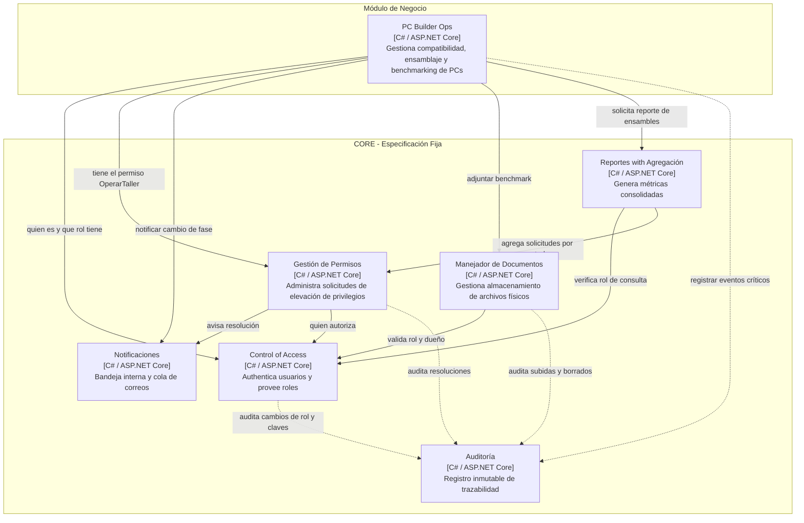

# PC Builder Ops

> **Sistema de Gestión de Ensamblaje y Pruebas de Computadoras Custom Para Empresas**  
> Proyecto de la asignatura **Programación III (TDS-007)** — ITLA (2026-C-3)

---

## Descripción del Proyecto
Plataforma orientada a talleres técnicos y tiendas especializadas de hardware para gestionar el ciclo operativo completo de computadoras personalizadas a pedido. El sistema valida la compatibilidad física y eléctrica de los componentes durante la cotización, coordina las etapas de montaje físico, y garantiza el control de calidad mediante el registro de pruebas de estrés térmico y estabilidad (benchmarking) antes de autorizar la entrega final al cliente.

## Stack Tecnológico
* **Lenguaje & Framework:** C# / .NET 10 (ASP.NET Core Web API)
* **Persistencia:** Entity Framework Core con base de datos relacional (SQL Server)
* **Autenticación & Seguridad:** JWT (JSON Web Tokens) con BCrypt y hashing salado
* **Arquitectura:** Diseño modular basado en componentes (C4 Nivel 3) con desacoplamiento estricto del Core

---

## Arquitectura del Sistema (Diagrama C4 Nivel 3)
El sistema se compone de seis piezas fijas del Core y el módulo de negocio independiente:



---

## Variables de Entorno Requeridas

Conforme a las directivas de seguridad **RF-NOT-13** y **RD-10**, ninguna credencial ni secreto se encuentra versionado en el código fuente. Configure las siguientes variables en el entorno de ejecución, consola o en su archivo local excluido de Git (`launchSettings.json`):

### Cadena de conexión a base de datos

La API, el despachador de correos y las migraciones resuelven la cadena de conexión en un solo punto (`CadenaConexion`), en este orden:

1. `CONNECTION_STRING` (variable de entorno directa)
2. `ConnectionStrings__DefaultConnection` (formato doble guion bajo para variables de entorno)
3. `ConnectionStrings:DefaultConnection` en la configuración de la API (solo la API)
4. Valor local por defecto, sin credenciales: `Server=localhost;Database=PCBuilderOps;Trusted_Connection=True;TrustServerCertificate=True`

### Clave secreta para JWT

La configuración de tokens se lee únicamente de variables de entorno, en un solo punto del código (`ConfiguracionJwt`), y la usan tanto la emisión como la validación de tokens. **No existe ninguna clave por defecto:** si `JWT_SECRET` falta o es demasiado corta, la API no arranca y lo indica en la consola.

| Variable | Obligatoria | Propósito |
|----------|-------------|-----------|
| `JWT_SECRET` | Sí | Clave de firma HMAC-SHA256 de los tokens. Mínimo 32 caracteres; use un valor aleatorio propio. |
| `JWT_ISSUER` | No (`PCBuilderOps`) | Emisor esperado del token. |
| `JWT_AUDIENCE` | No (`PCBuilderOps`) | Audiencia esperada del token. |
| `JWT_EXPIRACION_MINUTOS` | No (`60`) | Duración del token en minutos. |

Un valor adecuado para `JWT_SECRET` puede generarse en PowerShell con:

```powershell
[Convert]::ToBase64String((1..48 | ForEach-Object { Get-Random -Maximum 256 }))
```

> Las migraciones (`dotnet ef`) no arrancan la API: usan `AppDbContextFactory` y `PCBuilderOpsDbContextFactory`, y solo necesitan la cadena de conexión, no `JWT_SECRET`.

### Credenciales SMTP

| Variable | Alternativa | Propósito |
|----------|-------------|-----------|
| `SMTP_HOST` | — | Host del servidor SMTP (ej. smtp.gmail.com). |
| `SMTP_PORT` | — | Puerto de conexión al servidor SMTP (465 para SSL, 587 para STARTTLS). |
| `SMTP_USER` | — | Usuario o cuenta de correo autenticada ante el servidor SMTP. |
| `SMTP_PASS` | `SMTP_PASSWORD` | Contraseña de aplicación o token de autenticación SMTP. |
| `SMTP_FROM` | — | Dirección de remitente que figurará en el encabezado de los correos salientes. |

### Administrador inicial

El registro público siempre crea usuarios **Estándar**. Para disponer del primer **Administrador**, defina estas variables antes de ejecutar la API:

| Variable | Propósito |
|----------|-----------|
| `ADMIN_NOMBRE` | Nombre del primer Administrador (entre 2 y 100 caracteres). |
| `ADMIN_CORREO` | Correo del primer Administrador. |
| `ADMIN_PASSWORD` | Contraseña del primer Administrador (mínimo 8 caracteres, con letras y números). |

Al arrancar, si la base de datos **no tiene ningún Administrador**, la API crea esa cuenta ya activa y con rol Administrador (si el correo ya estaba registrado, lo promueve y le asigna esa contraseña). Si ya existe algún Administrador, las variables se ignoran, por lo que reiniciar la aplicación no duplica ni modifica cuentas. Las tres variables son obligatorias: si falta alguna, no se crea el Administrador. La consola indica si fue `Creado` o `Promovido`, o advierte si faltan variables.

Para usar `src/API/API.http`, complete al inicio del archivo `@adminCorreo` y `@adminPassword` con los mismos valores de `ADMIN_CORREO` y `ADMIN_PASSWORD`.

---

## Cómo ejecutar el proyecto

### 1. Clonar y preparar

```bash
git clone https://github.com/Joshua-Abreu/P3-PCBuilderOps.git
cd P3-PCBuilderOps
git checkout practica-3
```

Use la etiqueta de la entrega que se revisa (`practica-1`, `asignacion-2`, `practica-2`, `practica-3`). El módulo de negocio funcionando y su suite existen a partir de `practica-3`.

### 2. Restaurar dependencias

```bash
dotnet restore
```

### 3. Aplicar migraciones de base de datos

El Core y el módulo de negocio tienen cada uno su `DbContext` y sus migraciones, en la misma base de datos. Aplique los dos comandos **en este orden**, porque las tablas del negocio referencian a `Usuarios`. `dotnet ef` **no lee** `launchSettings.json`: si su base no es la local por defecto, defina `CONNECTION_STRING` en la terminal antes de ejecutarlos (en PowerShell: `$env:CONNECTION_STRING = "..."`).

```bash
dotnet ef database update --project src/Core --startup-project src/API --context AppDbContext
```

```bash
dotnet ef database update --project src/Modules/PCBuilderOps --startup-project src/API --context PCBuilderOpsDbContext
```

Para generar una nueva migración después de cambios en el modelo del Core:

```bash
dotnet ef migrations add <NombreMigracion> --project src/Core --startup-project src/API --output-dir Data/Migrations --context AppDbContext
```

Y en el módulo de negocio:

```bash
dotnet ef migrations add <NombreMigracion> --project src/Modules/PCBuilderOps --startup-project src/API --output-dir Data/Migrations --context PCBuilderOpsDbContext
```

### 4. Compilar

```bash
dotnet build P3-PCBuilderOps.slnx
```

### 5. Ejecutar

**API Web:**
```bash
dotnet run --project src/API
```

La API quedará escuchando en `http://localhost:5206` (o el puerto configurado en su perfil de host).

**Despachador independiente de correos:**
```bash
dotnet run --project src/Workers/EmailDispatcher
```

Este proceso independiente lee los correos pendientes de la cola, los envía vía SMTP y termina su ejecución limpiamente.

---

## Pruebas

Desde la raíz del repositorio, con el SDK de .NET 10 instalado:

```bash
dotnet test P3-PCBuilderOps.slnx
```

Ejecuta las dos suites (xUnit): `tests/Core.Tests` para Gestión de permisos y `tests/PCBuilderOps.Tests` para el módulo de negocio. **No requiere variables de entorno, SQL Server ni levantar la API** (RD-12): las máquinas de estados se prueban en memoria y los servicios usan una base SQLite en memoria nueva por cada prueba, por lo que las pruebas son independientes entre sí y del orden de ejecución.

### Módulo de negocio

| Archivo | Qué verifica |
|---------|--------------|
| `tests/PCBuilderOps.Tests/Domain/MaquinaEstadosOrdenEnsambleTests.cs` | Una prueba por cada fila de las tablas de [`docs/maquina-de-estados.md`](docs/maquina-de-estados.md): 3 permitidas y 13 prohibidas (rechazo y estado sin cambiar), más la prueba de que del estado terminal no se sale (RD-04, RF-NEG-03, 04, 05). |
| `tests/PCBuilderOps.Tests/Domain/OrdenEnsambleTests.cs` | Reglas de la orden: costo, reserva de stock, regla de la prueba más reciente y datos inválidos (FN-01 a 04). |
| `tests/PCBuilderOps.Tests/Domain/VerificadorCompatibilidadTests.cs` | Compatibilidad de socket y potencia, incluidos los límites (FN-01). |
| `tests/PCBuilderOps.Tests/Services/OrdenesServiceTests.cs` | Cada funcionalidad por separado, verificada sobre lo **guardado** en la base (RF-NEG-02, FN-01 a 05). |
| `tests/PCBuilderOps.Tests/Integracion/OperarTallerIntegracionTests.cs` | **Prueba de integración:** Gestión de permisos y el módulo reales, sin dobles y sin levantar la aplicación. `RegistrarPrueba_SeRechazaAntesDeAprobarLaSolicitudYSePermiteDespues` verifica las dos caras (RF-GP-05, FN-03). |

### Gestión de permisos

| Archivo | Qué verifica |
|---------|--------------|
| `tests/Core.Tests/Permisos/MaquinaEstadosSolicitudTests.cs` | Las 3 transiciones de la tabla son válidas y las 13 combinaciones restantes se rechazan (RD-04, RF-GP-06). |
| `tests/Core.Tests/Permisos/SolicitudPermisoTests.cs` | Reglas de la solicitud: nace Pendiente, aprobar registra quién y cuándo, rechazar exige motivo, transiciones prohibidas no cambian el estado, nadie resuelve la propia (RF-GP-01, 03, 04, 05, 06, 07). |
| `tests/Core.Tests/Permisos/GestionPermisosServiceTests.cs` | Lo mismo verificado sobre lo **guardado** en la base, más duplicados, otorgamiento del permiso y listados (RF-GP-01 a 07). |

Pruebas que piden expresamente la Asignación 2:
- **Transición válida:** `Aprobar_SolicitudPendiente_QuedaAplicadaYGuardaAprobadorYFecha` y `Rechazar_SolicitudPendienteConMotivo_QuedaRechazadaYGuardaMotivoAprobadorYFecha`.
- **Transición prohibida:** `Aprobar_DosVecesLaMismaSolicitud_SeRechazaYLoGuardadoNoCambia` y `Aprobar_SolicitudRechazada_SeRechazaYNoOtorgaElPermiso`.

Cada prueba indica en un comentario `// RF-GP-0N` el requisito que verifica. Pruebas representativas por requisito:

| Requisito | Prueba |
|-----------|--------|
| RF-GP-01 | `Crear_NuevaSolicitud_NaceEnPendienteSinResolucion`, `Crear_SolicitudNueva_SeGuardaEnPendienteConSolicitanteYFecha` |
| RF-GP-02 | `ListarPendientes_ConSolicitudesResueltas_DevuelveSoloLasPendientes`, `ListarDelSolicitante_ConSolicitudesDeOtros_DevuelveSoloLasPropias` |
| RF-GP-03 | `Aprobar_SolicitudPendiente_QuedaAplicadaYGuardaAprobadorYFecha` |
| RF-GP-04 | `Rechazar_SinMotivo_SeRechazaYLaSolicitudSigueIntacta` (motivo ausente, vacío o en blanco), `Rechazar_SolicitudAprobada_SeRechazaYElEstadoNoCambia` |
| RF-GP-05 | `Aprobar_SolicitudPendiente_OtorgaElPermisoAlSolicitante` |
| RF-GP-06 | `Aprobar_DosVecesLaMismaSolicitud_SeRechazaYLoGuardadoNoCambia`, `Aplicar_SolicitudRechazada_SeRechazaYElEstadoNoCambia`, `ValidarTransicion_TransicionFueraDeLaTabla_LanzaTransicionNoPermitida` |
| RF-GP-07 | `Aprobar_SolicitudPropiaDelAdministrador_SeRechazaYNoOtorgaElPermiso`, `Rechazar_PorElPropioSolicitante_SeRechazaYLaSolicitudSigueEnPendiente` |

---

## Defectos

Práctica 3. Cada defecto está plantado en un commit cuyo padre es `practica-3`, que modifica solo código de producción (ningún archivo de pruebas), y está etiquetado como `practica-3-defecto-N`. Para comprobarlo:

```bash
git checkout practica-3-defecto-N
```
```bash
dotnet test P3-PCBuilderOps.slnx
```

| N | Defecto plantado (archivo y línea) | Prueba que lo detecta | Comportamiento que comprueba |
|---|------------------------------------|-----------------------|------------------------------|
| 1 | `src/Modules/PCBuilderOps/Domain/MaquinaEstadosOrdenEnsamble.cs`, línea 10: se agrega `Cotizada → Entregada`, la primera transición de la tabla de prohibidas. | `TransicionarA_FilaProhibida_SeRechazaYElEstadoNoCambia(desde: Cotizada, hacia: Entregada)` | Pasar de Cotizada a Entregada se rechaza y la orden sigue Cotizada. |
| 2 | `src/Modules/PCBuilderOps/Domain/MaquinaEstadosOrdenEnsamble.cs`, línea 13: se agrega `Entregada → Cotizada`, una transición que parte del estado terminal. | `EstadoTerminal_DesdeEntregadaNoSaleNingunaTransicion` | Ninguna transición parte de Entregada. |
| 3 | `src/Modules/PCBuilderOps/Services/OrdenesService.cs`, líneas 67 y 68: se elimina la verificación de que el técnico tiene `OperarTaller`, condición de `Cotizada → EnArmado`, la primera fila que declara una. | `IniciarArmado_TecnicoSinPermiso_SeRechazaYLaOrdenSigueCotizada` | Con un técnico sin el permiso, el armado se rechaza y la orden sigue Cotizada, sin reservar stock. |
| 4 | `src/Modules/PCBuilderOps/Services/OrdenesService.cs`, línea 92: en `RegistrarPruebaAsync` se elimina la consulta a Gestión de permisos. | `RegistrarPrueba_SeRechazaAntesDeAprobarLaSolicitudYSePermiteDespues` (prueba de integración) | Registrar una prueba se rechaza mientras la solicitud no está aprobada y se permite después de que un Administrador la aprueba. |

Los defectos de la Práctica 2 se describen en el README de la etiqueta `practica-2`.

---

## Guía de Verificación de Criterios de Aceptación

Para reproducir cada criterio de la Práctica 1 se provee `src/API/API.http`, que puede ejecutarse desde Visual Studio Code (extensión REST Client) o importarse en Postman. Los tokens de activación y recuperación llegan por correo; si el despachador no está configurado, pueden leerse directamente en las tablas `TokensActivacion` y `TokensRecuperacion`.

### 1. Registro y activación (Bloque 1.1)

| Criterio | Cómo provocarlo | Resultado esperado |
|----------|-----------------|--------------------|
| **RF-CA-01** (Correo único) | `POST /api/auth/registro` con cuerpo `{"nombre": "...", "correo": "...", "password": "..."}` y repetirlo con el mismo correo. | El primero retorna `201 Created`; el segundo, `400 Bad Request` con mensaje controlado. |
| **RF-CA-02** (Hash con sal) | Registrar dos usuarios con la misma contraseña y ejecutar `SELECT Correo, PasswordHash FROM Usuarios`. | La contraseña no aparece en texto plano y los dos valores almacenados son distintos (BCrypt con sal aleatoria). |
| **RF-CA-14** (Política de contraseña) y **RD-07** | Registrar con una contraseña de 5 caracteres, sin números o sin letras, con un correo mal formado o vacío, y sin nombre o con un nombre de 1 carácter. Repetir la contraseña inválida en `POST /api/auth/cambiar-password` y en `POST /api/auth/restablecer-password`. | `400 Bad Request` con mensaje controlado en todos los casos, nunca una excepción sin manejar. |
| **RF-CA-15** (Cuenta inactiva hasta activar) | Iniciar sesión justo después de registrarse. | `401` con el mensaje "La cuenta no está activa." El correo de activación queda `Pendiente` en `CorreosEnCola`. |
| **RF-CA-16** (Enlace de un solo uso con vencimiento) | Abrir el enlace recibido (`GET /api/auth/activar?token=...`), abrirlo otra vez e iniciar sesión. | Primera apertura `200 OK`; segunda `400` sin cambiar el estado. El inicio de sesión funciona tras activar. El enlace vence a las 24 horas. |
| **RF-CA-17** (Reenvío neutro) | `POST /api/auth/reenviar-activacion` con un correo inexistente y con uno pendiente de activar. | Respuesta idéntica (`200 OK`) en ambos casos. El enlace anterior deja de servir. |

### 2. Sesión (Bloque 1.2)

| Criterio | Cómo provocarlo | Resultado esperado |
|----------|-----------------|--------------------|
| **RF-CA-03** (Inicio de sesión) | `POST /api/auth/login` con credenciales correctas, con contraseña incorrecta y con un correo inexistente. | Correctas: `200 OK` con token. Los dos rechazos son idénticos: `401` "Credenciales incorrectas." |
| **RF-CA-07** (Usuario autenticado) | `GET /api/auth/yo` con y sin cabecera `Authorization: Bearer <TOKEN>`. | Con token: identificador, correo y rol. Sin token: `401`. |
| **RF-CA-18** (Cierre de sesión) | `POST /api/auth/logout` y volver a usar el mismo token en `GET /api/auth/yo`. | El token cerrado se rechaza con `401`. |
| **RF-CA-19** (Bloqueo por intentos) | Fallar la contraseña cinco veces seguidas y en el sexto intento usar la correcta. | El sexto intento se rechaza indicando el bloqueo durante 15 minutos. Un inicio de sesión correcto antes del bloqueo pone el contador en cero. |

### 3. Roles y administración de usuarios (Bloque 1.3)

> **Requisito previo:** iniciar sesión con el Administrador definido en `ADMIN_CORREO` / `ADMIN_PASSWORD` (ver [Administrador inicial](#administrador-inicial)) y usar su token en las peticiones de esta sección.

| Criterio | Cómo provocarlo | Resultado esperado |
|----------|-----------------|--------------------|
| **RF-CA-04** (Dos roles) | `GET /api/usuarios` como Administrador. | Cada usuario tiene exactamente un rol: `Estandar` o `Administrador`. |
| **RF-CA-05** (Exigencia de rol en un punto) | Revisar `src/API/Controllers`. | Cada controlador declara su exigencia con `[Authorize]` o `[Authorize(Roles = "Administrador")]`. |
| **RF-CA-06** y **RD-06** (Rechazo a Estándar) | Con token de un usuario Estándar, invocar a mano `GET /api/usuarios` o `PUT /api/usuarios/{id}/rol`. | `403 Forbidden`. Sin token: `401`. |
| **RF-CA-08** (Cambio de rol) | Como Administrador, `PUT /api/usuarios/{id}/rol`. Como Estándar, intentar cambiar el rol propio. | Administrador: `200 OK`. Estándar: `403`, incluso sobre su propio rol. |
| **RF-CA-20** (Desactivar y reactivar) | `PATCH /api/usuarios/{id}/estado` con `{"activar": false}` sobre un usuario con sesión abierta; probar su token e iniciar sesión. Intentar desactivarse a sí mismo. | El token del usuario desactivado responde `401` y no puede iniciar sesión. La autodesactivación se rechaza con `403`. `{"activar": true}` lo reactiva. |
| **RF-CA-21** (Listado de usuarios) | `GET /api/usuarios?pagina=1&tamanoPagina=10` como Administrador y como Estándar. | Administrador: correo, rol y estado, sin hashes ni tokens. Estándar: `403`. |

### 4. Contraseñas: recuperación, cambio y restablecimiento (Bloque 1.4)

| Criterio | Cómo provocarlo | Resultado esperado |
|----------|-----------------|--------------------|
| **RF-CA-09** (Inicio de la recuperación) | `POST /api/auth/olvide-password` con un correo inexistente y con uno registrado. | Respuesta idéntica (`200 OK`) en ambos casos. |
| **RF-CA-10** (Código de un solo uso por la cola) | Revisar `CorreosEnCola` tras el paso anterior y usar el código dos veces. | El correo queda `Pendiente` con un enlace absoluto. El código vence a las 2 horas; el segundo uso se rechaza y la contraseña no cambia. |
| **RF-CA-11** (Nueva contraseña con el código) | `POST /api/auth/restablecer-password` con el código y una contraseña nueva; luego iniciar sesión con la anterior y con la nueva. | La anterior responde `401`; la nueva, `200 OK`. |
| **RF-CA-12** (Sesiones anteriores invalidadas) | Usar un token emitido antes del restablecimiento. | `401`. |
| **RF-CA-13** (Restablecimiento forzado por Administrador) | Con sesión de Administrador, `POST /api/usuarios/{id}/forzar-restablecimiento` (petición 14 de `API.http`). Luego iniciar sesión con la contraseña anterior (petición 15) y ejecutar el despachador de correos. | `200 OK`. La contraseña anterior deja de servir (`401`), las sesiones del usuario se revocan, los códigos previos se invalidan y se encola un correo con un código nuevo para definir la contraseña. Un Estándar recibe `403`. |
| **RF-CA-22** (Cambio de la propia contraseña) | Con sesión, `POST /api/auth/cambiar-password` con la contraseña actual incorrecta y luego con la correcta. | Incorrecta: `400`. Correcta: `200 OK`, se aplica la política (RF-CA-14) y se cierran las sesiones abiertas (RF-CA-12). |

### 5. Correo saliente por cola (Bloque 1.5)

| Criterio | Cómo provocarlo | Resultado esperado |
|----------|-----------------|--------------------|
| **RF-NOT-08** (La operación no depende del SMTP) | Dejar `SMTP_HOST` vacío o apuntando a un servidor inaccesible y registrar un usuario. | El registro responde `201` y el correo queda `Pendiente` en `CorreosEnCola`. |
| **RF-NOT-09** (Proceso independiente) | Con SMTP configurado, ejecutar `dotnet run --project src/Workers/EmailDispatcher`. | Envía los pendientes, los marca `Enviado` con `FechaEnvioUtc` y termina. El correo llega a la bandeja real. |
| **RF-NOT-12** (Sin duplicados) | Ejecutar el despachador dos veces seguidas. | La segunda ejecución no reenvía ningún correo ya enviado. |
| **RF-NOT-13** y **RD-10** (Credenciales fuera del repositorio) | Revisar el código y `git log -p`. | SMTP, JWT, cadena de conexión y Administrador inicial se leen solo de variables de entorno. |

### 6. Persistencia (RD-09)

| Criterio | Cómo provocarlo | Resultado esperado |
|----------|-----------------|--------------------|
| **RD-09** (Los datos sobreviven al reinicio) | Registrar un usuario, detener la API con `Ctrl+C`, volver a ejecutarla e iniciar sesión con ese usuario. | El usuario sigue existiendo: la información vive en SQL Server, fuera del proceso. |

### 7. Estructura de la máquina de estados de negocio (Bloque 1.6)

| Criterio | Dónde verlo | Resultado esperado |
|----------|-------------|--------------------|
| **RF-NEG-03 / RD-04** | `src/Modules/PCBuilderOps/Domain/`: la entidad `OrdenEnsamble`, sus estados (`EstadoOrdenEnsamble`) y la clase `MaquinaEstadosOrdenEnsamble`. | Estados y transiciones declarados en un solo lugar. |
| **RF-NEG-04 / RF-NEG-05** | `MaquinaEstadosOrdenEnsamble`. | Cuatro estados (Cotizada, EnArmado, EnPruebas, Entregada); Entregada es terminal y el salto directo Cotizada → Entregada se rechaza. |

Las tablas completas de transiciones permitidas y prohibidas están en [`docs/maquina-de-estados.md`](docs/maquina-de-estados.md).

### 8. Gestión de permisos (Asignación 2)

**Transiciones:** `Pendiente → Aprobada → Aplicada` (aprobar aplica el permiso automáticamente) y `Pendiente → Rechazada`. Cualquier otra se rechaza con `409 Conflict` y el estado no cambia. El único permiso del catálogo es `OperarTaller`, que da acceso a `GET /api/taller/ordenes`.

**Preparación:** iniciar sesión como Administrador (`ADMIN_CORREO` / `ADMIN_PASSWORD`) y registrar y activar un usuario Estándar (sección 1). Las peticiones 16 a 34 de `src/API/API.http` siguen este mismo orden (la 17 crea el técnico ya activo).

| Criterio | Cómo provocarlo | Resultado esperado |
|----------|-----------------|--------------------|
| **RF-GP-05** (antes de aprobar) | Con el token del Estándar, `GET /api/taller/ordenes`. | `403`: todavía no tiene el permiso. |
| **RF-GP-01** (Crear solicitud) | Con el token del Estándar, `POST /api/permisos/solicitudes` con `{"permiso": "OperarTaller"}`. Repetir la misma petición. | `201` con `"estado": "Pendiente"`. La repetición responde `409` (ya hay una pendiente). Un permiso inexistente responde `400`. |
| **RF-GP-02** (Consultar) | Con el token del Estándar, `GET /api/permisos/solicitudes/pendientes` y `GET /api/permisos/solicitudes/mias`. Con el del Administrador, `GET /api/permisos/solicitudes/pendientes`. | El Estándar recibe `403` en pendientes y en `mias` solo ve las suyas. El Administrador ve todas las pendientes. |
| **RF-GP-04** (Rechazar con motivo) | Como Administrador, `POST /api/permisos/solicitudes/{id}/rechazar` con `{}` y luego con `{"motivo": "No trabaja en el taller."}`. | Sin motivo: `400` y la solicitud sigue `Pendiente`. Con motivo: `200`, `"estado": "Rechazada"`, el motivo, el `aprobadorId` y la `fechaResolucionUtc`. |
| **RF-GP-06** (Rechazada → Aplicada) | Como Administrador, `POST /api/permisos/solicitudes/{id}/aprobar` sobre la solicitud rechazada. | `409` y la solicitud sigue `Rechazada`. |
| **RF-GP-03** (Aprobar) | El Estándar crea una solicitud nueva y el Administrador la aprueba con `POST /api/permisos/solicitudes/{id}/aprobar`. | `200` con `"estado": "Aplicada"`, el `aprobadorId` del Administrador y la `fechaResolucionUtc`. |
| **RF-GP-05** (Aplicación automática) | Con el **mismo token** del Estándar, sin volver a iniciar sesión, `GET /api/taller/ordenes`. | `200`: el permiso se aplicó al aprobar y se comprueba contra la base de datos en cada petición. |
| **RF-GP-06** (Aprobar dos veces) | Repetir `POST /api/permisos/solicitudes/{id}/aprobar` sobre la solicitud aplicada. | `409` y la solicitud sigue `Aplicada` con el mismo aprobador y la misma fecha. |
| **RF-GP-07** (Nadie resuelve la suya) | Con el token del Administrador, crear una solicitud (`POST /api/permisos/solicitudes`) y aprobarla o rechazarla él mismo. | `403` con el mensaje "No puedes resolver una solicitud creada por ti mismo." y la solicitud sigue `Pendiente`. |
| **RD-06** | Con el token del Estándar, `POST /api/permisos/solicitudes/{id}/aprobar`. | `403`. |
| **RD-09** | Detener y volver a ejecutar la API; repetir `GET /api/permisos/solicitudes/mias`. | Las solicitudes y el permiso otorgado siguen ahí. |

### 9. Módulo de negocio (Práctica 3)

**Estados:** `Cotizada → EnArmado → EnPruebas → Entregada`. Las transiciones permitidas y prohibidas, quién las ejecuta y sus condiciones están en [`docs/maquina-de-estados.md`](docs/maquina-de-estados.md). Toda respuesta de error usa el formato `{"mensaje": "..."}`.

**Preparación:** ejecutar antes las peticiones 16 a 30 de `src/API/API.http` (técnico con `OperarTaller` aprobado). Las peticiones 35 a 62 siguen el mismo orden de esta tabla. Se necesita un token de Administrador, uno de cliente (Estándar) y uno de técnico (Estándar con `OperarTaller`).

**Componentes de ejemplo** (`GET /api/componentes`; se cargan con la migración del módulo):

| Id | Componente | Uso en las pruebas |
|----|------------|--------------------|
| `a1000000-0000-0000-0000-000000000001` | CPU Ryzen 7 7700X (AM5, 105 W) | |
| `a1000000-0000-0000-0000-000000000002` | CPU Core i5-13600K (LGA1700, 125 W) | Provoca un socket incompatible con la placa AM5. |
| `a2000000-0000-0000-0000-000000000001` | Placa TUF Gaming B650-Plus (AM5, 40 W) | |
| `a3000000-0000-0000-0000-000000000001` | GPU RTX 4060 (115 W) | |
| `a3000000-0000-0000-0000-000000000002` | GPU RTX 4090 (450 W, **stock 1**) | Provoca falta de potencia y falta de stock. |
| `a6000000-0000-0000-0000-000000000001` | Fuente RM850x (850 W) | |
| `a6000000-0000-0000-0000-000000000002` | Fuente 450 BR (450 W) | No alcanza para la RTX 4090. |

| Funcionalidad | Cómo provocarla | Resultado esperado |
|---------------|-----------------|--------------------|
| **RF-NEG-06** (Sin sesión) | Sin token, `GET /api/ordenes/mias`. | `401`. |
| **FN-01** (Cotizar) | Como cliente, `POST /api/ordenes` con `{"componentes": [{"componenteId": "...", "cantidad": 1}]}`, incluyendo CPU, placa y fuente compatibles. | `201` con `"estado": "Cotizada"`, el código de seguimiento y el costo total. |
| **FN-01** (Incompatible) | Repetir con la CPU LGA1700 y la placa AM5; luego con la RTX 4090 y la fuente de 450 W. | `400` que indica el socket o la potencia. No se crea ninguna orden. |
| **RF-NEG-06** (Rol) | Como Administrador, `POST /api/ordenes`. Como cliente, `POST /api/ordenes/{id}/iniciar-armado`. | `403` en ambos casos. |
| **FN-05** (Consultar) | Como cliente, `GET /api/ordenes/mias` y `GET /api/ordenes/{id}`. Con el token de otro usuario, `GET /api/ordenes/{id}`. | El cliente ve sus órdenes con componentes y pruebas. El otro usuario recibe `404`. |
| **RF-NEG-04** (Transición prohibida) | Como Administrador, `POST /api/taller/ordenes/{id}/entregar` sobre la orden Cotizada. | `409` y la orden sigue `Cotizada`. |
| **FN-02** (Sin permiso) | Como Administrador, `POST /api/ordenes/{id}/iniciar-armado` con `{"tecnicoId": "..."}` y el id de un usuario sin `OperarTaller`. | `400` y la orden sigue `Cotizada`, sin técnico. |
| **FN-03** (Sin permiso) | Con el token de un Estándar sin el permiso, `POST /api/taller/ordenes/{id}/pruebas`. | `403`: la operación exige un permiso aprobado en Gestión de permisos. |
| **FN-02** (Iniciar armado) | Como Administrador, `POST /api/ordenes/{id}/iniciar-armado` con el id del técnico. | `200` con `"estado": "EnArmado"` y el técnico asignado. El stock de sus componentes baja en `GET /api/componentes`. |
| **FN-04** (Pasar a pruebas) | Como técnico, `POST /api/taller/ordenes/{id}/pasar-a-pruebas`. | `200` con `"estado": "EnPruebas"`. |
| **FN-04** (Entrega sin pruebas) | Como técnico, `POST /api/taller/ordenes/{id}/entregar`. | `409` y la orden sigue `EnPruebas`. |
| **FN-03** (Registrar prueba) | Como técnico, `POST /api/taller/ordenes/{id}/pruebas` con `{"tipoSoftwarePrueba": "Cinebench", "temperaturaMaximaCpu": 98, "temperaturaMaximaGpu": 65, "puntajeBenchmark": 12000, "esAprobada": false}`. | `201` con la prueba en la orden. Sin `esAprobada`, con temperatura fuera del rango de 0 a 150 °C o sin software: `400`. |
| **FN-04** (Última reprobada) | Como técnico, `POST /api/taller/ordenes/{id}/entregar`. | `409` y la orden sigue `EnPruebas`. |
| **FN-04** (Entregar) | Registrar otra prueba con `"esAprobada": true` y repetir `POST /api/taller/ordenes/{id}/entregar`. | `200` con `"estado": "Entregada"`. Decide la prueba más reciente; la reprobada queda como historial. |
| **RF-NEG-05** (Estado terminal) | Repetir `POST /api/taller/ordenes/{id}/entregar`. | `409` y la orden sigue `Entregada`. |
| **FN-02** (Sin stock) | Cotizar dos órdenes con la RTX 4090 e iniciar el armado de ambas. | La primera `200`; la segunda `409`, sigue `Cotizada` y no se descuenta nada. |
| **RF-NEG-09** (Independencia) | Revisar `src/Modules/PCBuilderOps/Domain/MaquinaEstadosOrdenEnsamble.cs`. | Tiene sus propios estados y su propia excepción, sin nada de Gestión de permisos. El módulo solo le consulta si el usuario tiene el permiso, desde `OrdenesService`. |
| **RD-09** | Detener y volver a ejecutar la API; repetir `GET /api/ordenes/mias`. | Las órdenes siguen ahí. |
